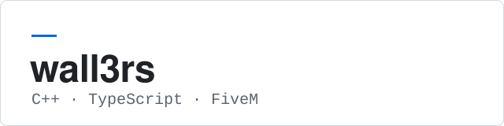

<picture>
  <source media="(prefers-color-scheme: dark)" srcset="assets/banner-dark.svg">
  
</picture>

C++ and TypeScript, mostly around the FiveM platform.

## About

I contribute performance and stability fixes to FiveM's C++ client and server, mostly in the CEF-based NUI layer, the resource scheduler and streaming lookups. Outside the engine I work on TypeScript tooling for FiveM, and I build small static sites for a Dutch roleplay community.

## Open Source

Pull requests are currently under review.

- **NUI rendering — citizenfx/fivem** (C++): a series of small, independent changes to the CEF-based UI layer. A shared lock for window lookups, merging excessive dirty rects on the CPU upload path, less per-frame work in `UpdateFrame`, and a configurable windowless frame rate.
  [#4225](https://github.com/citizenfx/fivem/pull/4225) · [#4227](https://github.com/citizenfx/fivem/pull/4227) · [#4228](https://github.com/citizenfx/fivem/pull/4228) · [#4229](https://github.com/citizenfx/fivem/pull/4229) · [#4232](https://github.com/citizenfx/fivem/pull/4232) · [#4234](https://github.com/citizenfx/fivem/pull/4234)
- **Engine hot paths — citizenfx/fivem** (C++): contiguous storage for resource scheduler iteration, a hashed map for streaming hash-key lookups, and a single tick-clock read per server frame.
  [#4224](https://github.com/citizenfx/fivem/pull/4224) · [#4226](https://github.com/citizenfx/fivem/pull/4226) · [#4233](https://github.com/citizenfx/fivem/pull/4233)
- **NUI texture failure path — citizenfx/fivem** (C++, Direct3D 11): fixes a null dereference in `GtaNuiTexture` when creating a texture from a CEF shared handle fails partway through.
  [#4273](https://github.com/citizenfx/fivem/pull/4273)
- **fivem-artifacts-db — jgscripts** (TypeScript, Next.js): cached server routes for GitHub lookups to spare visitors' rate limits, batched commit-date requests, and better keyboard and screen-reader support.
  [#40](https://github.com/jgscripts/fivem-artifacts-db/pull/40)

## Projects

- **[Nextupwetboek](https://github.com/wall3rsyt/Nextupwetboek)** (HTML, CSS, JavaScript): a single-page criminal code reference for a roleplay server, with client-side search by article or topic. Served with GitHub Pages.

## Technologies

C++ · TypeScript · JavaScript · Next.js · CEF · Direct3D 11 · HTML/CSS · Git
